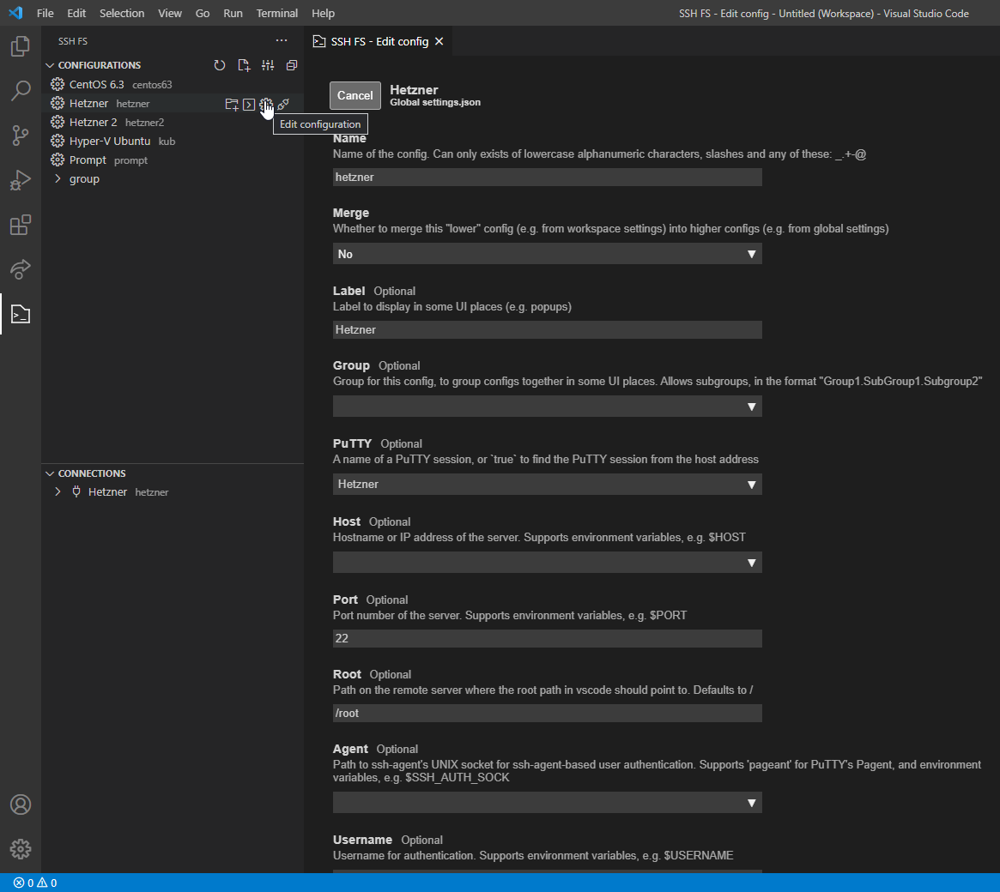
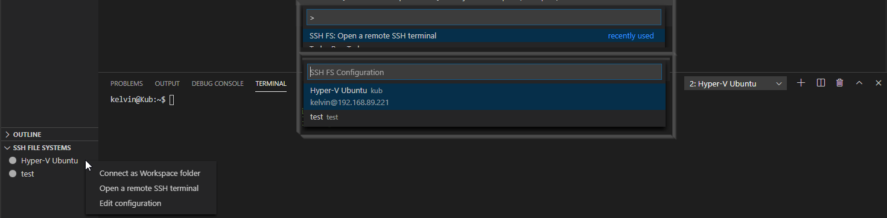
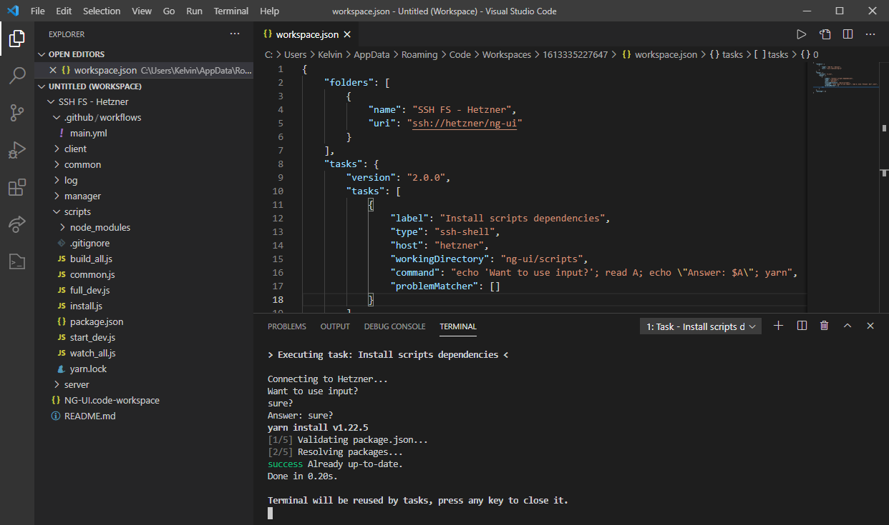
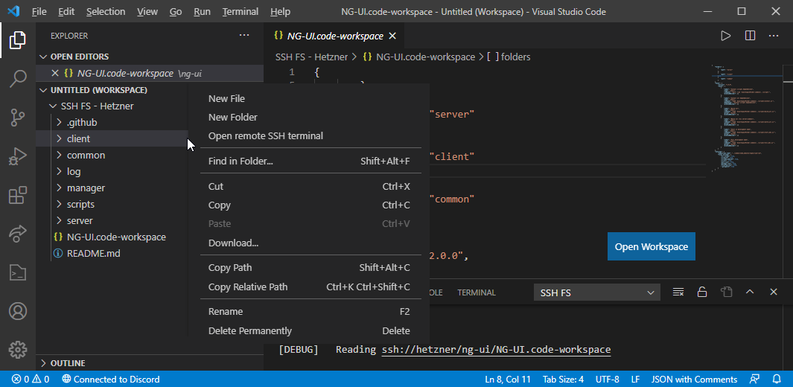
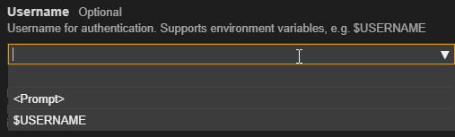
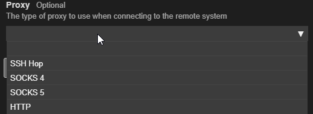
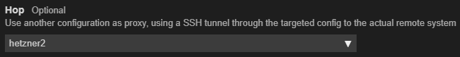
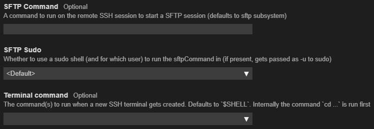

# SSH FS


[](https://github.com/SchoofsKelvin/vscode-sshfs)
[](https://marketplace.visualstudio.com/items?itemName=Kelvin.vscode-sshfs)
[](https://open-vsx.org/extension/Kelvin/vscode-sshfs)

[](https://marketplace.visualstudio.com/items?itemName=Kelvin.vscode-sshfs)
[](https://github.com/sponsors/SchoofsKelvin)
[](https://www.paypal.me/KSchoofs)

This extension allows mounting remote folders as local workspace folders, launch integrated remote terminals and run `ssh-shell` tasks.

## Getting started

There are two ways to tell SSH FS about your servers:

1. **Use your existing OpenSSH config (recommended, nothing to set up).** Every host in `~/.ssh/config` shows up in the SSH FS view automatically. Keys loaded in your SSH agent with `ssh-add` are used directly, so no password or passphrase has to be entered or stored in VS Code. See [Hosts from your OpenSSH config file](#hosts-from-your-openssh-config-file) and [Passphrase-protected keys with ssh-add](#passphrase-protected-keys-with-ssh-add).
2. **Create SSH FS configurations manually.** Use the [config editor](#config-editor) described further below for hosts that aren't in your OpenSSH config, or for SSH FS specific options. Keep in mind that a password or passphrase saved in such a configuration is stored as plain text in your `settings.json`.

Quick start for the first option:

```sh
# 1. Describe the host once, in ~/.ssh/config
#      Host myserver
#          HostName server.example.com
#          User me
#          IdentityFile ~/.ssh/id_ed25519

# 2. Load your key in the SSH agent (asks for its passphrase once, in your terminal)
ssh-add ~/.ssh/id_ed25519

# 3. Check that the key is loaded
ssh-add -l
```

Then open the SSH FS view, where `myserver` is listed, and pick `Add as Workspace folder` or `Open remote SSH terminal`. No prompt appears.

## Features

### Hosts from your OpenSSH config file

Every host in your `~/.ssh/config` (and the system-wide `ssh_config`) is listed in the SSH FS view, ready to be mounted as workspace folder or opened in a terminal. Nothing has to be configured in VS Code and nothing is copied into your settings: the file is read every time (changes are picked up automatically) and it stays the single source of truth.

```
Host bastion
    HostName bastion.example.com
    User admin
    IdentityFile ~/.ssh/id_ed25519

Host app
    HostName 10.0.0.12
    User deploy
    ProxyJump bastion
    RemoteCommand tmux new -A -s main

Host legacy
    HostName legacy.internal
    ProxyCommand ssh -W %h:%p bastion
```

- **Authentication works like `ssh`**: first the keys in your SSH agent, then your `IdentityFile`s (or the default `~/.ssh/id_*` keys), then keyboard-interactive and password.
- **Keys loaded with `ssh-add` never ask for a passphrase**: every key that `ssh-add -l` lists is used straight from the agent, the key file isn't even opened. If an `IdentityFile` is configured, that key is taken from the agent first (and with `IdentitiesOnly yes`, only that key). The agent is looked for at `IdentityAgent` / `SSH_AUTH_SOCK`, then at the standard location of your platform (the OpenSSH Authentication Agent service or Pageant on Windows, launchd on macOS, the desktop keyring/systemd socket on Linux) and finally among agents you started by hand (`eval $(ssh-agent)`), so it also works when VS Code wasn't started from the terminal you ran `ssh-add` in. Use `IdentityAgent none` to not use an agent for a host.
- A passphrase is only prompted as a last resort, for an encrypted key that isn't loaded in any agent. Prompted passphrases and passwords are **never stored**: they only live in memory while that connection is being set up. The `SSH FS` output channel tells which agent and keys were used (or why not).
- **`ProxyJump`**: one or more (comma-separated) jump hosts, each `[user@]host[:port]`. Jump hosts are resolved against your OpenSSH config as well, so they can have their own keys, users, ports and even their own `ProxyJump`.
- **`ProxyCommand`**: the command is run locally (through your shell) and used as the connection, with the `%h`, `%p`, `%r`, `%n` and `%%` tokens.
- **`RemoteCommand`**: run instead of the default shell when opening a terminal for the host. File access (SFTP) is not affected.
- Also supported: `Include` (with globs), `Host` patterns and negation, `Match` (`all`, `host`, `originalhost`, `user`, `localuser`, `final`), `HostName`, `User`, `Port`, `IdentitiesOnly`, `ForwardAgent`, `SetEnv`, `ConnectTimeout`, `ServerAliveInterval`, `ServerAliveCountMax`, `PreferredAuthentications`, `PubkeyAuthentication`, `PasswordAuthentication` and `KbdInteractiveAuthentication`. `Match exec` blocks are never executed and thus never apply.
- Instant connections (e.g. `user@host.example.com`) also apply your OpenSSH config, e.g. a `Host *.example.com` block with a `ProxyJump`.
- The `Edit configuration` button of such a host opens the config file at the right line. The command `SSH FS: Open OpenSSH config file` opens (or creates) the file.

Related settings (user settings only): `sshfs.sshConfig.enabled`, `sshfs.sshConfig.paths` (other files to read), `sshfs.sshConfig.exclude` (hosts to hide, e.g. `github.com`) and `sshfs.sshConfig.root` (the folder to open, defaults to the remote home directory `~`).

A regular SSH FS configuration with the same name as a host takes precedence over that host. To set SSH FS specific options for a host (e.g. a different root folder), create a regular SSH FS configuration with the same name and `"merge": true`. Everything not specified in there is taken from your OpenSSH config:

```json
"sshfs.configs": [
    { "name": "app", "merge": true, "root": "/srv/app" }
],
```

The fields `proxyJump`, `proxyCommand`, `remoteCommand`, `identityFiles` and `identitiesOnly` can also be used in regular SSH FS configurations. A `proxyCommand` in a configuration that doesn't come from your user settings is only honored in trusted workspaces.

### Passphrase-protected keys with ssh-add

A key that is loaded in your SSH agent never needs its passphrase in VS Code, exactly like with `ssh` or the Remote - SSH extension:

- Run `ssh-add <path to your key>` once per login session and enter the passphrase in your terminal. `ssh-add -l` lists the keys that are loaded.
- SSH FS uses every listed key straight from the agent. The key file isn't opened and nothing is stored.
- **Windows**: enable and start the `OpenSSH Authentication Agent` service (or run Pageant) before using `ssh-add`.
- **macOS**: `ssh-add --apple-use-keychain <key>` also saves the passphrase in your Keychain. After a restart, `ssh-add --apple-load-keychain` loads the key again without asking for it.
- **Linux**: the agent of your desktop session (GNOME Keyring, `ssh-agent.socket`) or one started with `eval $(ssh-agent)` is found automatically.

If you still get a passphrase prompt, the key isn't in an agent SSH FS could find. The `SSH FS` output channel tells where it looked. Adding `IdentityAgent <value of $SSH_AUTH_SOCK in your terminal>` to a `Host *` block in `~/.ssh/config` points SSH FS (and `ssh`) at the right agent.

### Config editor

*Manual configuration is optional: hosts from your OpenSSH config file (see above) work without it.*

The built-in config editor makes it easy to create and edit configurations:


The config editors stores this, by default, in your User Settings (`settings.json`) as:

```json
"sshfs.configs": [
    {
        "name": "hetzner",
        "putty": "Hetzner",
        "label": "Hetzner",
        "hop": "hetzner2",
        "root": "/root"
    }
],
```

This config is configured to copy settings (e.g. username, host, ...) from my PuTTY session. Due to me having loaded my private key in Pageant (PuTTY's agent), this config allows me to create a connection without having to provide a password/passphrase. It also specifies that all file operations _(`ssh://hetzner/some/file.js`)_ are relative to the `/root` directory on the server.

Configurations are read from your global User Settings, the current workspace's settings, and any JSON files configured with `sshfs.configpaths`. Even when the workspace overrides this setting, the globally-configured paths will still be read. The workspace versions do have higher priority for merging or ignoring duplicates.

### Terminals

Using a simple button or the command palette, a remote terminal can be started:


_Uses `$SHELL` by default to launch your default user shell. A config option exists to change this, e.g. `"ksh -"` or `"exec .special-profile; $SHELL"`_

If a connection is already opened for a configuration, there is no need to reauthenticate. As long as the configuration hasn't changed, existing connections (both for workspace folders and terminals) will be reused.

### Remote shell tasks

A new task type `ssh-shell` is added to run shell commands remotely:


The task terminal opens a full PTY terminal on the server.

### Remote workspace folders

Using a simple button or the command palette, we can mount a remote workspace folder as a regular local workspace folder:


_Same configuration used as from the [Config editor](#Config editor) above._

This works seamlessly with extensions using the `vscode.workspace.fs` API _(added in VS Code 1.37.0)_, although not all extensions switched over, especially ones making use of binary files.

As can be seen, right-clicking a remote directory gives the option to instantly open a remote terminal in this directory.

The extension supports any `ssh://` URI. I actually opened `ssh://hetzner/ng-ui` as my folder, which resolves to `/root/ng-ui` on my remote server. By default, the button/command opens `ssh://hetzner/` which would then mount `/root`, as that is what my `Root` config field is set to. You can set it to whatever, including `~/path`.

### Miscellaneous

The extension comes with a bunch of other improvements/features. Internally the [ssh2](https://www.npmjs.com/package/ssh2) package is used. The raw config JSON objects _(as seen in [Config editor](#Config editor))_ is, apart from some special fields, a one-on-one mapping of the config options supported by this package. Power users can edit their `settings.json` to e.g. make use of the `algorithms.cipher` field to specify a list of ciphers to use.

Some other features worth mentioning:

#### Prompt host/username/password/... for every connection



Active connections are reused to minimize prompts. A connection gets closed if there's no terminal or file system using it for over 5 seconds.

#### Proxy settings

Several proxy types (SSH hopping, HTTP and SOCKS 4/5) are supported:



`SSH Hop` refers to using another configuration to hop through, similar to OpenSSH's `ProxyJump`:



#### SFTP Command/Sudo and Terminal command



The extension supports using a custom `sftp` subsystem command. By default, it uses the `sftp` subsystem as indicated by the remote SSH server. In reality, this usually results in `/usr/lib/openssh/sftp-server` being used.

The `SFTP Command` setting allows specifying to use a certain command instead of the default subsystem. The `SFTP Sudo` setting makes the extension try to create a sudo shell _(for the given user, or whatever sudo defaults to)_ and run `SFTP Command` _(or `/usr/lib/openssh/sftp-server` by default)_. For most users, setting this to `<Default>` should allow operating on the remote file system as `root`. Power users with esoteric setups can resort to changing `SFTP Command` to e.g. `sudo /some-sftp-server`, but might run into trouble with password prompts.

The `Terminal command` option, as mentioned in [Terminals](#terminals), allows overriding the command used to launch the remote shell. By default, the extension launches a remote shell over the SSH connection, runs `cd ...` if necessary, followed by `$SHELL` to start the user's default shell. This config option allows to replace this `$SHELL` with a custom way way of starting the shell, or configuring the provided default SSH shell.

## Links

- [GitHub](https://github.com/SchoofsKelvin/vscode-sshfs) ([Issues](https://github.com/SchoofsKelvin/vscode-sshfs/issues) | [(Pre)-releases](https://github.com/SchoofsKelvin/vscode-sshfs/releases) | [Roadmap](https://github.com/SchoofsKelvin/vscode-sshfs/projects/1) | [Sponsor](https://github.com/sponsors/SchoofsKelvin))
- [Visual Studio Marketplace](https://marketplace.visualstudio.com/items?itemName=Kelvin.vscode-sshfs)
- [Open VSX Registry](https://open-vsx.org/extension/Kelvin/vscode-sshfs)
